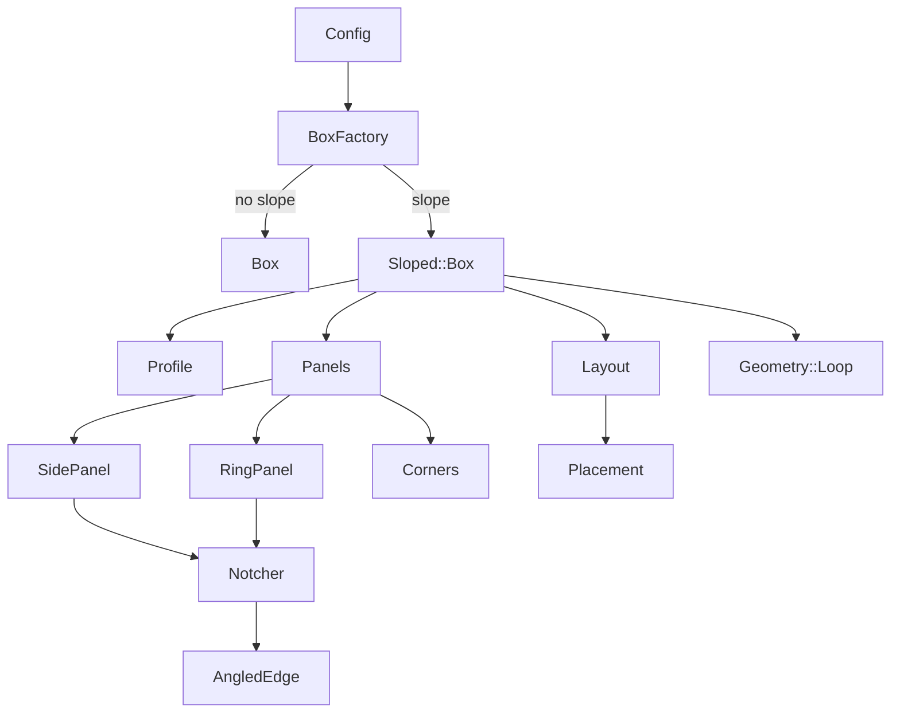

# Plan 004.01: draw the sloped box

Follows `docs/decisions/decisions-on-angled-box.md`. PR #25 built `Geometry::Transform`, `Notching::AngledEdge` and `Sloped::Profile`. This plan draws the box.

## Outcome

`laser-cutter generate -b 4x3x5/0.125 --slope 45 --front-height 1 -o box.pdf` writes seven panels: two sides, bottom, back, top strip, tilted panel, front strip. Without `--slope` nothing changes.

## Design



- **`Geometry::Loop`**: a closed outline as ordered points. It drops repeated points, spikes and collinear points, grows by a distance (the kerf), and turns into lines.
- **`Sloped::Notcher`**: the notched path from one point to another, through `AngledEdge` without kerf.
- **`Sloped::RingPanel`**: a rectangular panel. Each long edge is notched or plain; each end is notched for a stretch and covers the side wall for the rest; each corner square is its own or not.
- **`Sloped::SidePanel`**: the five-sided wall, with the two triangles that close the wedges under the strips.
- **`Sloped::Corners`**: which panel owns the corner cube at each square corner of the side.
- **`Sloped::Panels`**: the seven panels, each in its own frame.
- **`Sloped::Layout`** and **`Sloped::Placement`**: where each panel goes on the sheet.
- **`Sloped::Box`**: the facade the renderers use, with the interface of `Box`: `generate_notches`, `outlines`, `notches`, `enclosure`, `metadata=`.
- **`BoxFactory`**: picks `Box` or `Sloped::Box`. The two renderers ask it instead of naming `Box`.

### Joints

| Joint                                                    | Kind                                                                              |
| -------------------------------------------------------- | --------------------------------------------------------------------------------- |
| side to bottom, back, top strip, front strip             | notched, side centre in                                                           |
| side to tilted panel                                     | notched with `--lid full`; plain with `--lid plain`, the panel lying on the sides |
| bottom to back, bottom to front strip, back to top strip | notched; back and front strip centre out                                          |
| tilted panel to a strip                                  | plain butt joint, the strip covering the end of the side                          |
| tilted panel to back or bottom, a strip dropped          | plain, both ending at the corner                                                  |

A corner cube goes to the back or the front strip, unless both of its notches at that corner are holes; then the bottom or the top strip takes it.

### Kerf

Every panel is built without kerf and its loop is then grown by half the kerf. That is exact at the corners that are not square.

### Sheet

```text
        +-------+
        | front |
        +-------+
        | tilted|
        +-------+
        |  top  |
+------++-------++------+
| side || back  || side |
+------++-------++------+
        | bottom|
        +-------+
```

The metadata block keeps its place at the bottom left.

### Options

- `--slope DEGREES`, above 0 and below 90. `--front-height HF`, zero or more.
- `--slope` needs `--front-height`, and `--front-height` needs `--slope`.
- `--lid back` with `--slope` raises `InvalidOption`.
- Both are `Options` attributes, and are printed in the metadata.

## Steps

1. `Geometry::Loop`, with specs.
1. `Notcher`, `RingPanel`, `SidePanel`, `Corners`, `Panels`, with specs that every joint interlocks.
1. `Placement`, `Layout`, `Sloped::Box`, `BoxFactory`; renderers through the factory.
1. `Configuration`, `Types`, `Options`, `generate`, metadata.
1. README, `CLAUDE.md`, decisions.

## Done when

- `just lint` and `just test` are green, coverage above 95%.
- A PDF and an SVG of a sloped box render, with and without each strip, for both lids.
- The six-panel box draws exactly what it drew before.
