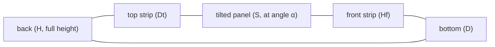

# Decisions on the angled box

Source: `spec/wishes/wish-tilted-box.png`, plan `004.00`.

## What the wish image shows

A console box, the kind that holds an LCD tilted towards the reader. Seen from the side, the profile is a pentagon:

- **Sides:** two pentagons, notched on all five edges, the sloped one included.
- **Back, bottom:** rectangles notched on all four sides, as today.
- **Tilted panel (LCD), top strip, front strip:** rectangles notched only on their ends, into the sides. Their long edges, where they meet each other at an angle, are plain.
- Seven panels, not six.

## Verdict: feasible

- **Notching a sloped edge** needs no change to the notch algorithm. Lay the edge flat in a local frame, notch it with `Edge` + `PathGenerator`, turn the lines back. Built in this PR: `Geometry::Transform`, `Notching::AngledEdge`.
- **Mating:** the tilted panel is a plain rectangle. Its ends and the sloped wall edge have the same length, so they get the same notch count and width; opposite `center_out` makes them interlock. Covered by `angled_edge_spec.rb`.
- **Aggregator:** no change needed. Sloped edges draw no corner boxes, so nothing on them is drawn twice; their lines pass through as `skewed`.
- **Angled butt joints** (tilted panel to the strips) stay plain, as in the image. They meet at an angle other than 90°, so the panel lengths need a thickness correction, or the joint is glued with a small gap. To settle (Q3).
- **Renderers:** both draw lines, so PDF and SVG need nothing new.

## Shape of the work

- `Box` stays the six-panel box. The angled box is a new class beside it (open/closed), sharing `Edge`, `PathGenerator`, `AngledEdge`, `Aggregator`.
- Sides become polygons; a `Geometry::Polygon` with sides at any angle is the next piece.
- A new `Options` attribute and `generate` flag select it.

## Open questions

- [ ] **Q1. Parameters.** Which four numbers define the profile? Proposal: depth `D`, back height `H`, front height `Hf`, angle `α` of the tilted panel; the top strip depth follows, `Dt = D − (H − Hf) / tan α`, and must be ≥ 0.
- [ ] **Q2. CLI.** A new command (`laser-cutter console …`) or a flag on `generate` (`--slope 30`)?
- [ ] **Q3. Angled joints.** Plain butt joint with a thickness correction, plain with a gap for glue, or notched?
- [ ] **Q4. Lid options.** Does `--lid` apply to the angled box, or is it always closed?
- [ ] **Q5. Range.** Allowed angles: 0 < α < 90, and which panel disappears at the extremes (top strip when `Dt = 0`, front strip when `Hf = 0`)?
