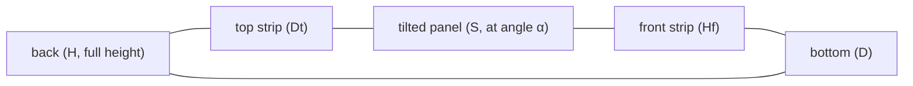

# Decisions on the angled box

Source: `spec/wishes/wish-tilted-box.png`, plan `004.00`.

## What the wish image shows

A console box, the kind that holds an LCD tilted towards the reader. Seen from the side, the profile is a pentagon:

- **Sides:** two pentagons, notched on all five edges, the sloped one included.
- **Back, bottom:** rectangles notched on all four sides, as today.
- **Tilted panel (LCD), top strip, front strip:** rectangles notched only on their ends, into the sides. Their long edges, where they meet each other at an angle, are plain.
- Seven panels, not six.

## Verdict: feasible

- **Notching a sloped edge** needs no change to the notch algorithm. Lay the edge flat in a local frame, notch it with `Edge` + `PathGenerator`, turn the lines back. Built in this PR: `Geometry::Transform`, `Notching::AngledEdge`.
- **Mating:** the tilted panel is a plain rectangle. Its ends and the sloped wall edge have the same length, so they get the same notch count and width; opposite `center_out` makes them interlock. Covered by `angled_edge_spec.rb`.
- **Aggregator:** no change needed. Sloped edges draw no corner boxes, so nothing on them is drawn twice; their lines pass through as `skewed`.
- **Angled joints** (tilted panel to the strips) are plain butt joints, as in the image. See *Decided*.
- **Renderers:** both draw lines, so PDF and SVG need nothing new.

## Decided

- **Parameters:** depth `D`, back height `H`, front height `Hf`, slope `α` in degrees, all of the inside outline. The top strip follows: `Dt = D − (H − Hf) / tan α`. `Sloped::Profile` computes it.
- **Invocation:** flags on `generate`: `--slope DEGREES` and `--front-height HF`. No `--slope` means today's six-panel box. Each flag gets an `Options` attribute.
- **Angled joints:** plain butt joints, outside faces meeting. At the obtuse corners the strip runs past the corner over the tilted panel's end, and the tilted panel stops short:
  - top strip: `Dt + t / sin α`; front strip: `Hf + t / cos α`
  - tilted panel: `S − t / tan α` (top) `− t · tan α` (front)
  - The joint is not flush. The strip's square end stands proud of the tilted face, and a wedge of the same size stays open inside, under the strip, to be glued. The size is the length the tilted panel stops short by: `t / tan α` at the top strip, `t · tan α` at the front strip. Both are 0.25 at 45° in quarter-inch stock.
  - Where a strip is dropped the corner is acute, and both panels end at the corner. Their square ends touch along the inside edge only, which leaves a V-shaped groove open on the outside and little surface to glue.
- **Lid:** `--lid` applies to the tilted panel: `full` (notched into both sides, fixed) or `plain` (lies on the sides, lifts off). `back` raises `InvalidOption`: no back wall touches the tilted panel.
- **Range:** `0 < α < 90`. The top strip is dropped when `Dt = 0` and the front strip when `Hf = 0`; with both dropped the side is a three-cornered wedge. A negative `Dt` raises `InvalidOption`, and so does a tilted panel with no length left, which a steep slope or a tall front causes.

## Shape of the work

- `Box` stays the six-panel box. The angled box is a new class beside it (open/closed), sharing `Edge`, `PathGenerator`, `AngledEdge`, `Aggregator`.
- Built: `Geometry::Transform`, `Notching::AngledEdge`, `Sloped::Profile`.
- Next: the side wall as a polygon, notched along every edge; the seven panels laid out; `--slope` and `--front-height` on `generate`.
- MakeABox.io previews the box; its preview must draw the sloped box too.
