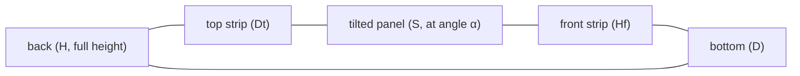
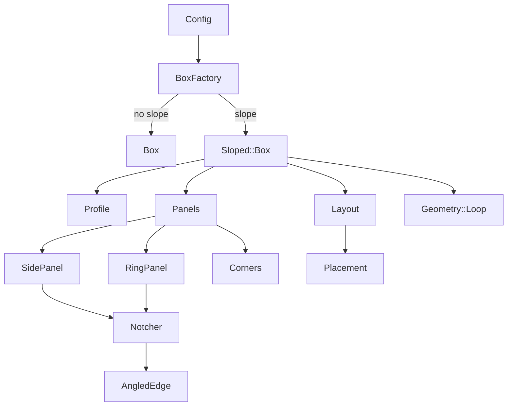

# Decisions on the angled box

Source: `spec/wishes/wish-tilted-box.png`, plan `004.00`.

## What the wish image shows

A console box, the kind that holds an LCD tilted towards the reader. Seen from the side, the profile is a pentagon:



- **Sides:** two pentagons, notched on all five edges, the sloped one included.
- **Back, bottom:** rectangles notched on all four sides, as today.
- **Tilted panel (LCD), top strip, front strip:** rectangles notched only on their ends, into the sides. Their long edges, where they meet each other at an angle, are plain.
- Seven panels, not six.

## Decided

- **Parameters:** depth `D`, back height `H`, front height `Hf`, slope `α` in degrees, all of the inside outline. The top strip follows: `Dt = D − (H − Hf) / tan α`. `Sloped::Profile` computes it.
- **Invocation:** flags on `generate`: `--slope DEGREES` and `--front-height HF`. No `--slope` means today's six-panel box. Each flag gets an `Options` attribute.
- **Angled joints:** plain butt joints, outside faces meeting. At the obtuse corners the strip runs past the corner over the tilted panel's end, and the tilted panel stops short:
  - top strip: `Dt + t / sin α`; front strip: `Hf + t / cos α`
  - tilted panel: `S − t / tan α` (top) `− t · tan α` (front)
  - The joint is not flush. The strip's square end stands proud of the tilted face, and a wedge of the same size stays open inside, under the strip, to be glued. The size is the length the tilted panel stops short by: `t / tan α` at the top strip, `t · tan α` at the front strip. Both are 0.25 at 45° in quarter-inch stock.
  - Where a strip is dropped the corner is acute, and both panels end at the corner. Their square ends touch along the inside edge only, which leaves a V-shaped groove open on the outside and little surface to glue.
- **Lid:** `--lid` applies to the tilted panel: `full` (notched into both sides, fixed) or `plain` (lies on the sides, lifts off). `back` raises `InvalidOption`: no back wall touches the tilted panel.
- **Range:** `0 < α < 90`. The top strip is dropped when `Dt = 0` and the front strip when `Hf = 0`; with both dropped the side is a three-cornered wedge. A negative `Dt` raises `InvalidOption`, and so does a tilted panel with no length left, which a steep slope or a tall front causes.
- **`--slope` needs `--front-height`**, and the other way round: `MissingOption` and `InvalidOption`. A front height of zero is said, not assumed.

## Joints

| Joint                                                    | Kind                                                                  |
| :------------------------------------------------------- | :-------------------------------------------------------------------- |
| side to bottom, back, top strip, front strip             | notched; the side has a hole in the middle                            |
| side to tilted panel                                     | notched with `--lid full`; plain with `--lid plain`, the panel on top |
| bottom to back, bottom to front strip, back to top strip | notched; the back and the front strip have a tab in the middle        |
| tilted panel to a strip                                  | plain butt joint                                                      |
| tilted panel to the back or the bottom, a strip dropped  | plain, both ending at the corner                                      |

- **Strip ends:** a strip is notched into the side wall for its inside length (`Dt` or `Hf`). Past that, over the end of the tilted panel, it is a thickness wider at each end and covers the side wall.
- **The wedge:** the side wall carries a triangle under each strip, up to the outside face of the tilted panel, so the wedge the butt joint leaves is closed at both ends.
- **Corner cubes:** at each square corner of the side wall, three panels meet and one fills the cube. The back or the front strip takes it, unless both of its notches at that corner are holes; then the bottom or the top strip does.
- **A plain lid** is `W + 2t` wide and as long as the tilted panel. It lies on the straight slope of the side walls, between the strips.

## Shape of the code



- `Box` stays the six-panel box. `Sloped::Box` is a new class beside it, with the same interface, and `BoxFactory` picks one.
- **A sloped edge** is notched by laying it flat: `Notching::AngledEdge` turns the edge into a local frame with `Geometry::Transform`, notches it with `Edge` and `PathGenerator`, and turns the lines back.
- **Outlines are loops, not aggregated lines.** Each panel is one walk of points, a `Geometry::Loop`, which drops repeated points, spikes and points in the middle of a run. `Aggregator` merges only lines along an axis, so it could not do this for a sloped edge.
- **Kerf** grows each loop by half the kerf, corners kept sharp. At a corner that is not square, moving each notch by the kerf would leave a gap; growing the loop does not. On square panels it equals what `Box` draws.
- **Sheet:** the panels unfold around the back: a side wall either side of it, the bottom below, and the top strip, the tilted panel and the front strip above, in the order they wrap round the box. The right wall is the mirror image of the left. The metadata block stays at the bottom left.

```text
        +-------+
        | front |
        +-------+
        | tilted|
        +-------+
        |  top  |
+------++-------++------+
| side || back  || side |
+------++-------++------+
        | bottom|
        +-------+
```

## Next

- MakeABox.io previews the box; its form needs the two fields, and a release of this gem to call.
- A real cut, to check the fit of the butt joints and of the wedge.
